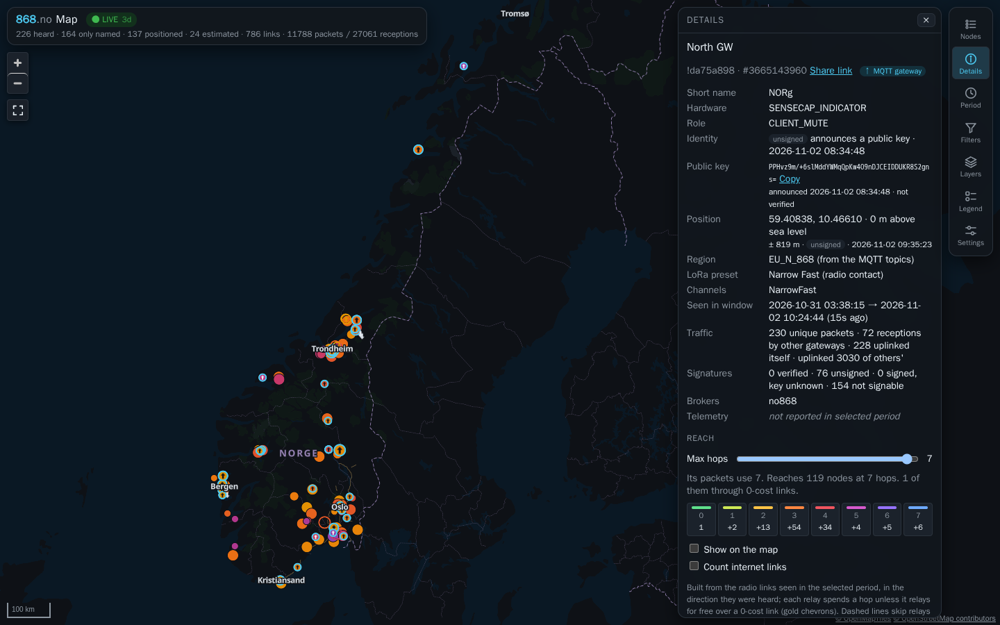
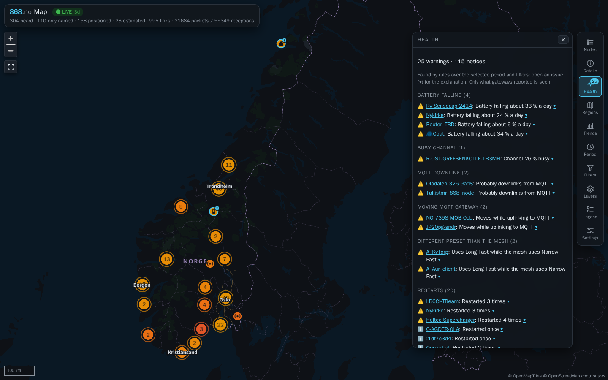
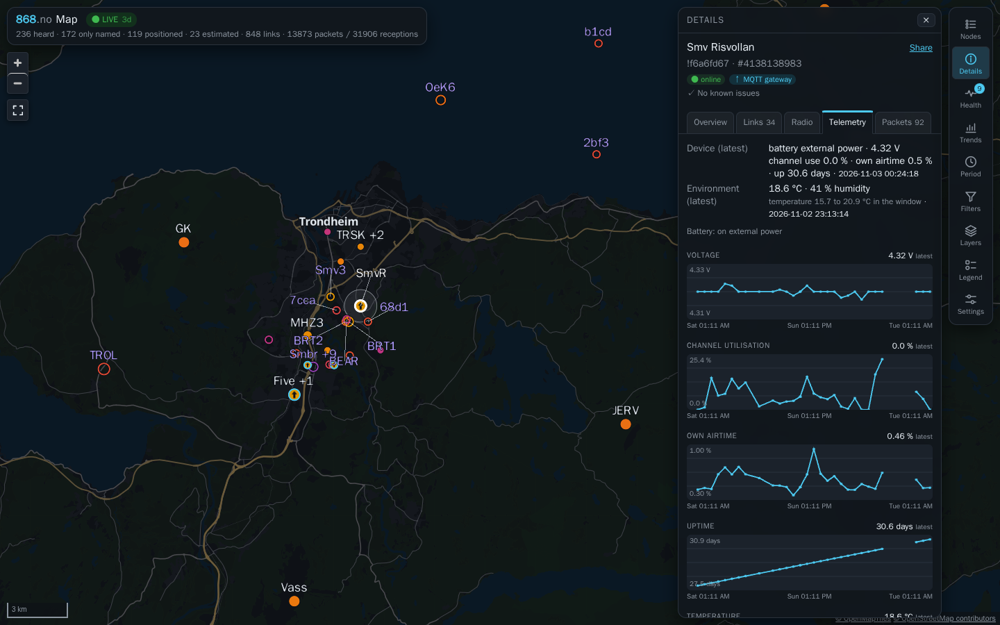
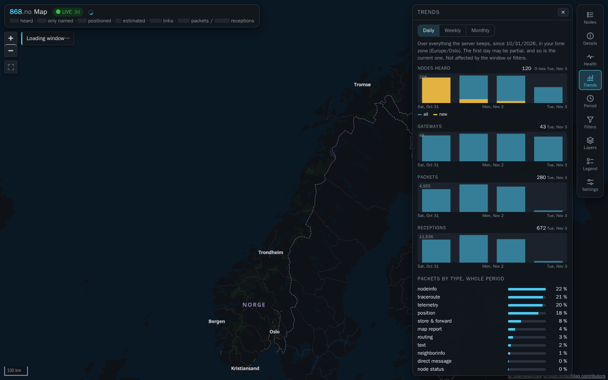

# 868.no Map

An interactive map, in light and dark themes, for observing Meshtastic mesh networks using only traffic from one or more MQTT brokers. It decrypts channel traffic, verifies XEdDSA packet signatures and stores each accepted gateway reception in one PostgreSQL table (`packet_log`). From that table the browser reconstructs nodes, evidence-backed RF links, traffic and coarse location estimates for any time window in the retention period. Nothing from outside the selected window ever leaks into a view. [docs/design.md](docs/design.md) describes how it works and why.



| Health | Telemetry | Trends |
|---|---|---|
|  |  |  |

- **Time windows:** default rolling 3 days, presets from 1 h to 7 d, custom start/end, slide the window back through 6 months. Live updates arrive over SSE.
- **Honest topology:** links come from NeighborInfo, traceroute segments, proven direct gateway receptions, and uniquely resolved relay bytes (low confidence, dashed). Confidence counts the evidence: high when observed 3 or more times or in more than one way, medium once or twice (D-087). Every link shows provenance, per-direction SNR/RSSI statistics and a confidence reason.
- **Live pings:** each transmission heard live animates as a ring at the transmitter and a line to each direct receiver (D-053); an ACK animates as a confirmed delivery, and a traceroute reply replays the route its request took (D-096, D-106). The link layers start switched off.
- **MQTT bridges:** the glyph inside the marker shows how a node uplinks to MQTT: ↑ a gateway (the first copy of each packet), a double chevron one that uplinks every copy it hears (D-084). A small ↓ beside the marker means it probably downlinks: its traceroute hops read exactly 0 dB, as packets taken from the broker do (D-054). Hops into downlinking nodes recorded at exactly 0 dB are internet links, drawn dotted green in their own layer and never counted as radio links (D-055).
- **0-cost links and reach:** hop limits seen before and after each relay reveal routers that relay a favourite's packets without spending a hop, one direction at a time (gold chevrons, D-068). A selected node's panel simulates how far its packets get at each hop limit, 0 to 7, from the links seen, and can draw that on the map (D-069).
- **Honest positions:** reported positions only from in-window packets, never made finer than their owners shared them. Estimates need ≥ 3 well-spaced anchors and are drawn as hollow markers with an uncertainty circle; there are no guessed pins. Marker colour is when a node was last heard, on one gold-to-violet ramp with a logarithmic time scale (D-085, D-087).
- **Node details in tabs:** Overview, Links (each link opens with its signal over time), Radio, Telemetry (battery, voltage, channel use, airtime, uptime and sensor readings charted over the selected period) and Packets (packet log with ACKs and errors, delivery rates by recipient, airtime, signatures), with the node's health issues always on top (D-098, D-100, D-105, D-109).
- **Mesh health:** rules flag traceroute flooding, busy channels, downlinkers, nodes on another preset, hop limits far above need, falling batteries, restarts, possible impersonation and more, and an airtime estimate shows who keeps the channel busy, store-and-forward included (D-095, D-099, D-103, D-108).
- **Weather:** hourly weather from MET Norway at stationary routers' sites, drawn behind their telemetry charts (temperature, humidity, cloud cover and sunlight) and in a wind chart, and as precipitation behind links' signal charts (D-133).
- **Long-term trends:** daily, weekly and monthly nodes, new nodes, gateways, packets and receptions over the whole retention period (D-104, D-112).
- **Nothing heard is dropped:** encrypted direct messages and channels without a key are kept as headers only, packets that fail verification are kept out of the map, and old rows are decoded again when the decoder improves (D-091, D-093, D-107).
- **Crypto:** AES-CTR and firmware 2.8.1+ AES-CCM channels, firmware-compatible XEdDSA verification with trust-on-first-use, and per-packet status (`verified`, `unsigned`, `unverifiable`, `not-applicable`). Verified against real firmware 2.8 traffic.
- **Tool rail and themes:** every control sits on a floating, resizable tool rail panel (Nodes, Details, Health, Trends, Period, Filters, Layers, Legend, Settings) beside a header island with the live indicator and counters (D-066, D-082, D-097). The map remembers where you left it. The theme follows the browser by default (Auto); viewers can pick Light or Dark under Settings.
- **Privacy:** no accounts, cookies, analytics or third-party requests (unless an online basemap is configured); a [privacy policy](frontend/public/privacy.html) at `/privacy.html` fills in the deployment's operator, contact and retention from the API.
- **Installable and offline-capable:** add it to a phone's home screen; without a connection it opens with the last data it received (map tiles are not stored offline).
- **Self-hosted:** Docker Compose, a self-hosted PMTiles basemap with switchable layers (roads, borders and city and country names on by default; local place names, peaks, road names and water names off) and an optional regions layer that splits Norway into Nord-Norge, Trøndelag, Vestlandet, Østlandet and Sørlandet. The only outside services it uses at runtime are the basemap service's OpenStreetMap downloads when it builds and, unless turned off, MET Norway's weather archive (`thredds.met.no`, `WEATHER_ENABLED`) and Kartverket's terrain heights (Geonorge, `TERRAIN_ENABLED`), which the backend queries.

## Quick start (demo)

Requires Docker with Compose.

```sh
cp .env.example .env          # set POSTGRES_PASSWORD and DEMO_MODE=true
docker compose --profile demo up -d --build
open http://localhost:8080
```

The `demo` profile adds a local Mosquitto broker (compose network only) and a simulator for a 22-node mesh in Trøndelag. The simulator uses real encryption and signatures, flood relaying via several gateways, traceroutes, NeighborInfo, plaintext uplinks, unpositioned nodes, a relay-byte collision, and deliberately bad input: forged signatures and PKI DMs, which must be kept header-only, and malformed protobufs, which must be rejected. It refuses to publish to non-private hosts.

The `basemap` service starts too and downloads several GB of OpenStreetMap data for its first build; the map works without tiles until it finishes. Add `--scale basemap=0` to skip it.

## Real brokers and keys

```sh
mkdir -p secrets && cp config/examples/*.yaml secrets/
# edit secrets/mqtt-brokers.yaml  (several brokers: TLS/CA, credentials, client id, topic filters, v5 or v311)
# edit secrets/channel-keys.yaml  (several channels: name, mode ctr|ccm, PSKs current-first for rotation;
#                                  unlisted channels are tried with the default key)
# .env: DEMO_MODE=false, strong POSTGRES_PASSWORD
docker compose run --rm backend check-config     # redacted summary or readable errors
docker compose up -d --build
```

Channel PSKs are symmetric channel keys, not node public keys. Secrets live in `./secrets` (mounted read-only); they are never logged, stored or returned by the API.

## Map tiles

The default is a self-hosted PMTiles archive, built on first start (and refreshed monthly) by the `basemap` service and served by the `web` service. To use an online OpenMapTiles-schema provider instead, set `MAP_TILE_SOURCE` to a TileJSON URL and allow its host with `CSP_CONNECT_EXTRA` on the `web` service; visitors' browsers then contact that tile host. See [docs/basemap.md](docs/basemap.md).

## Tests

The host needs only Docker; Go and Node run in containers.

```sh
scripts/go.sh go test ./...           # backend unit tests (incl. real-capture replay)
scripts/integration.sh                # Postgres/Redis/Mosquitto integration tests (time isolation, pipeline, retention)
scripts/node.sh npx vitest run        # frontend unit tests
scripts/wasm.sh test                  # engine (Rust) tests, incl. the golden 12 h fixture
scripts/wasm.sh                       # build the engine to WebAssembly (needed before frontend tests/builds)
docker run --rm --network host --ipc=host -v "$PWD":/src -w /src/frontend \
  mcr.microsoft.com/playwright:v1.64.1-noble npx playwright test     # e2e against a running demo stack built with
                                      # E2E_HOOKS=true, DEMO_MODE=true and seeded history (as CI does)
                                      # (add -e UPDATE_SCREENSHOTS=1 to refresh docs/screenshots)
scripts/bench.sh                      # 2M-row reference benchmark
```

Linters (CI runs them all; fix what they report before pushing):

```sh
scripts/go.sh go vet ./... && scripts/go.sh gofmt -l .          # Go basics
scripts/go.sh golangci-lint run ./...  # Go linters (backend/.golangci.yml); --fix applies the safe fixes
scripts/go.sh govulncheck ./...        # Go: known vulnerabilities in code paths actually called
scripts/wasm.sh clippy                 # Rust: clippy, warnings as errors (lint set in frontend/engine/Cargo.toml)
scripts/wasm.sh deny                   # Rust: dependency advisories, bans and sources (frontend/engine/deny.toml)
scripts/node.sh npm run lint           # TypeScript/React: ESLint (frontend/eslint.config.js)
scripts/node.sh npm run knip           # unused files, exports and dependencies (frontend/knip.json); --fix removes them
```

The two Go tools install once into the cached GOBIN: `scripts/go.sh go install github.com/golangci/golangci-lint/v2/cmd/golangci-lint@v2.15.0` and `scripts/go.sh go install golang.org/x/vuln/cmd/govulncheck@v1.9.0`. Formatters beyond `gofmt` (rustfmt, Prettier) are not used: the code keeps its own layout, which they would rewrite.

Every view is built in the browser, by a WebAssembly engine (`frontend/engine`, Rust) in a Web Worker, from the decoded rows of `/api/v1/observations` and the live stream (D-031, D-040, D-041).

## Operations

Health at `/health/ready`, metrics at `backend:9100/metrics`. Retention runs daily (6 calendar months by default). Backups (not automated) use `pg_dump` of `packet_log`; Redis is disposable. See [docs/operations.md](docs/operations.md) for deployment behind HTTPS, access control, data-loss windows, importing history from Meshstellar, troubleshooting and the production security checklist.

## Documentation

| Document | Contents |
| --- | --- |
| [docs/design.md](docs/design.md) | How the system works and why: principles, ingest, storage, API, the browser engine, every derived view and map rule, testing, limitations |
| [docs/architecture.md](docs/architecture.md) | Components, network diagram, data model, time isolation, trust model |
| [docs/protocol-compatibility.md](docs/protocol-compatibility.md) | Pinned upstream revisions; crypto, signing and traceroute facts verified against firmware |
| [docs/operations.md](docs/operations.md) | Deploy, configure, monitor, back up, troubleshoot |
| [docs/basemap.md](docs/basemap.md) | Basemap build, style, glyphs, licences |
| [THIRD_PARTY_NOTICES.md](THIRD_PARTY_NOTICES.md) | Licenses of dependencies, fonts and map data |
| [docs/benchmarks.md](docs/benchmarks.md) | Reference-workload results |
| [docs/api-openapi.yaml](docs/api-openapi.yaml) | OpenAPI 3.1, generated from the serving code (also at `/api/openapi.yaml`) |

## Limitations

- The map shows what this service received over MQTT while it was running. It is not a complete history; gaps occur while brokers or the service are down.
- Timestamps are receive times (`observed_at`), not RF transmission times.
- Trust in node keys is trust-on-first-use; it lapses when a key's announcement ages out of retention.
- AES-CTR decryption proves nothing about integrity. Unsigned and unverifiable packets are labelled, not authenticated.
- Relay hints are single bytes: ambiguous matches produce no link. RF-based location estimates are coarse; uncalibrated estimates only say "somewhere among these anchors".
- Minimum supported firmware: 2.7.

## License

[GNU General Public License v3.0](LICENSE) (`GPL-3.0-only`). The backend's protocol code is generated from [Meshtastic's protobuf definitions](https://github.com/meshtastic/protobufs), which are GPL-3.0, so the whole project is too. Distributing it, including serving the frontend to visitors' browsers, means offering the corresponding source: the map links to the source it was built from (set `SOURCE_URL` in `.env` before building the web image of a modified version). Third-party components, fonts and map data, and their licenses: [THIRD_PARTY_NOTICES.md](THIRD_PARTY_NOTICES.md).

Map data © OpenStreetMap contributors, © OpenMapTiles.

Meshtastic® is a registered trademark of Meshtastic LLC. This project is not affiliated with or endorsed by Meshtastic LLC.
